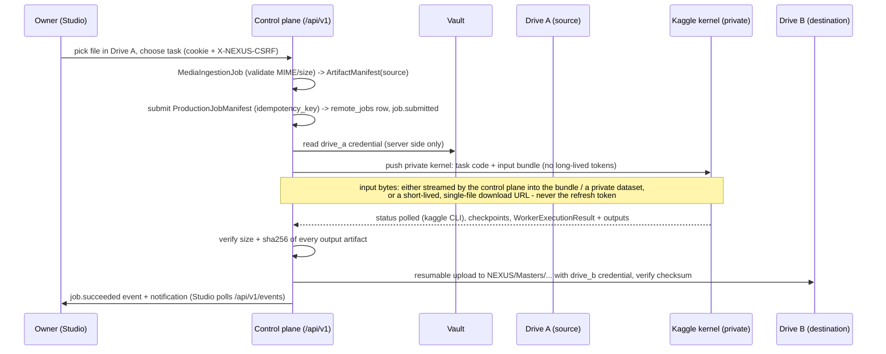

# Account 1 - cloud platform architecture (storage, compute, automation)

Scope: the layer that lets NEXUS take media from a cloud source, process it on remote (free) compute and deliver the
result to cloud storage **without the owner's PC being involved**, and that Accounts 2 (editing / rendering / video
generation) and 3 (research, translation, localisation, publishing, analytics) plug into. Companion documents:
`docs/ACCOUNT1_CONTRACTS.md` (data + behaviour contracts), `docs/ACCOUNT1_SECURITY_MODEL.md` (threat model),
`docs/ARCHITECTURE.md` (the local product as built).

## 1. Repository audit (verified 2026-11-12 with `git log` / `git branch -a`, not taken from reports)

| Ref | Commit | What it is |
|---|---|---|
| `origin/main` | `ec5af11` | Phase 3b plan (docs). CI green. |
| `origin/claude/hopeful-allen-luubcy` | `c93847d` | **PR #3 (draft, not merged)**: 98 commits on top of `main` - session 6 final acceptance (8 demos, 7 done; generated video blocked on GPU), Review page, release check PASS. Merging needs the owner. |
| `origin/claude/optimistic-franklin-376ndo` | `ffe6cfa` | PR #2 line; fully contained in `hopeful-allen-luubcy` (recovered by fast-forward, see `docs/MASTER_ROADMAP.md` section 1). |
| `origin/claude/intelligent-faraday-y28cx1` | - | older session branch, contained in the above. |
| `origin/work/account-1-cloud-platform` | `6f8d792` | **Account 1 base**: `c93847d` + one commit (contracts v1, vault, migration 2, event bus, owner auth, `/api/v1` router mounts). Sub-agent worktrees branch from here. |

Consequences: Account 1 work is stacked on an unmerged PR. `main` has none of it. When PR #3 is merged the account
branch rebases cleanly (it only adds files plus small edits to `api.py` / `db.py`). `NEXUS_STATE.json` /
`NEXUS_HANDOFF.md` auto blocks were stale at the time of this audit (they name `intelligent-faraday` @ `c39c8c9`); they
are regenerated by the lead's `nexus checkpoint`, not by sub-agents.

## 2. Current architecture (as built before Account 1)

* **App**: one FastAPI process (`nexus/api.py`, ~800 lines, legacy routes under `/api/*`), single-page UI
  `nexus/ui/index.html`, bound to `127.0.0.1:8765` by `nexus start` (`nexus/launcher.py`).
* **Persistence**: SQLite in WAL mode at `NEXUS_HOME/nexus.db` (`nexus/db.py`). Append-only migrations tracked with
  `PRAGMA user_version` (1 = durable job ledger, 2 = Account 1 cloud tables).
* **Durable jobs**: `nexus/jobs.py` - a job is a row, handlers are named stage sequences with per-stage checkpoints,
  heartbeats every 5 s, `recover()` re-queues jobs of dead workers. Workers are separate processes
  (`python -m nexus worker`) or an embedded thread (`NEXUS_EMBEDDED_WORKER`).
* **Zero-spend guard**: `nexus/costguard.py` authorises every component/host against `registry/components.yaml`, refuses
  known paid endpoints and records every decision (`ledger`).
* **Storage (local product)**: `nexus/storage/` `StorageBackend` (local, rclone) used by verified/encrypted backups
  (`nexus/backup.py`).
* **Compute (local product)**: `nexus/compute.py` - local worker real, Kaggle/Colab adapters were stubs, remote GPU
  simulated.

## 3. The Account 1 layer

```
                     Owner (browser: Remote Studio /studio, phone or PC)         Accounts 2 / 3 (code, same repo)
                                   | HTTPS + session cookie / bearer                  | Python API or /api/v1 + bearer
+----------------------------------v-------------------------------------------------v--------------------------+
| CONTROL PLANE  FastAPI app  /api/v1/*  (nexus/api.py mounts nexus/cloud/routes_*.py)                           |
|  routes_core (lead)      contracts, events, notifications, session                                             |
|  routes_security (A)     health, secrets (names only), audit, repo scan          security.py: require_owner,    |
|  routes_compute (B)      submit/cancel/retry remote jobs, workers, pull protocol   CSRF, headers, worker tokens |
|  routes_storage (C)      Drive OAuth (web + device), connections A/B/C, transfers, ingest                      |
|  routes_studio (D)       Studio page, scheduler control                                                        |
|  events.py  ProductionEvent / NotificationEvent bus (redacted)   audit.py  security audit log                   |
|  vault.py   Fernet-encrypted secrets in NEXUS_HOME/secrets (tokens never leave the server)                      |
+------+----------------------+--------------------------+--------------------------+---------------------------+
       | SQLite (WAL) nexus.db: remote_jobs, remote_checkpoints, cloud_events, notifications, artifacts,         |
       | transfers, cloud_connections, scheduler_state, security_audit (+ legacy tables)                         |
       v                      v                          v                          v
 COMPUTE PROVIDERS (B)   STORAGE ADAPTERS (C)       INGEST (C)                  SCHEDULER (D)
 local | kaggle (private | local | gdrive x3         upload | http_url (SSRF-   periodic: pick work, submit
 kernels, CLI) |         (drive_a, drive_b,         safe) | drive_file |        manifests, pause on quota,
 colab / user_gpu        drive_c), resumable        artifact -> MediaIngestion  stop on errors
 (pull workers with      upload, checksums          Job -> ArtifactManifest
 per-worker tokens)
```

Ownership of the package: see section 9. Every provider is an adapter behind `nexus/cloud/compute` or
`nexus/cloud/storage`; nothing else imports a provider SDK (AGENTS.md rule).

## 4. Data flows

### 4.1 Drive source -> remote worker -> Drive destination (owner PC not involved)



Where the bytes travel: Drive A -> control-plane host (temporary file in `NEXUS_HOME`, deleted after upload) -> worker
-> control plane -> Drive B. The control-plane host is the Codespace / server, **not the owner's PC**. A worker never
holds a Drive refresh token or the owner token; a pull worker holds only its own revocable worker token.

### 4.2 Pull workers (Colab notebook, owner's own GPU box)

```
worker (outbound HTTPS only) --- Bearer nxw_... + X-NEXUS-Worker ---> /api/v1/compute/pull/*  (claim, heartbeat,
   checkpoint, result upload)        control plane verifies sha256(token) in constant time, scopes to its own jobs
```
The worker opens no port; revoking its token stops it at the next request.

### 4.3 Accounts 2 and 3 submitting work

```
Account 2/3 module -> ProductionJobManifest(task="<registered task>", owner_account="account2", inputs=[art_...],
   output_destination="drive_b", idempotency_key=...) -> dispatcher -> WorkerExecutionResult.artifacts
   -> ArtifactManifest (consumed by the next stage / publishing package)
```

## 5. Deployment topology options (no paid host is chosen)

| Option | Use | Reachability | Auth mode | Notes |
|---|---|---|---|---|
| Owner's Windows PC (`NEXUS_START.bat`) | the existing local product | `127.0.0.1` only | loopback | no cloud flow without the PC; still the default product |
| GitHub Codespaces / cloud dev container | development, demos, the current Account 1 control plane | forwarded port, **private visibility** (GitHub login required) | **set `NEXUS_API_TOKEN`** - forwarded requests carry proxy headers and are treated as remote | ephemeral: `NEXUS_HOME` and the vault vanish with the Codespace (back up the vault key - security model section 8); free monthly core-hours are a quota |
| A real always-on host (free tier VM, home server, NAS) | 24/7 scheduler, webhooks | HTTPS via reverse proxy / tunnel | `NEXUS_API_TOKEN` + `NEXUS_VAULT_KEY` from the host's secret store, `NEXUS_PUBLIC_ORIGIN` | **owner decision** (account authorisation; must be zero cost without a card on file). Not chosen here. |

In every option: one control-plane process + one worker process share one SQLite file; compute providers are remote and
interchangeable; storage connections are per owner account.

## 6. Observability

| Signal | Where | Endpoint |
|---|---|---|
| Liveness | `GET /api/v1/health/live` (unauthenticated, returns only `{"ok": true}`) | uptime monitor |
| Health | version, mounted/missing routers (`nexus.api.CLOUD_MISSING`), db + schema, vault (counts, undecryptable), disk free, auth mode | `GET /api/v1/health` (owner) |
| Production history | `cloud_events` (+ notifications) | `GET /api/v1/events?since=`, `/api/v1/notifications` |
| Security history | `security_audit` (auth failures, lockouts, sessions, worker tokens, connections, scans) | `GET /api/v1/security/audit` |
| Job detail | `remote_jobs`, `remote_checkpoints`, worker `log_tail` (redacted) | routes_compute |
| Quotas | `QuotaStatus` per connection (measured / provider API only drive decisions) | routes_compute / routes_storage |
| Logs | `NEXUS_HOME/logs/{api,worker}.log`, `logs/jobs/<id>.log` | files on the host |
| Cost | `costguard` ledger (always 0.0) | `/api/spend` |

## 7. How Accounts 2 and 3 plug in

1. **Register a task** in the compute task registry (`nexus/cloud/compute/tasks.py`, sub-agent B): a lower_snake_case
   name (validated by `ProductionJobManifest`), the code the worker runs, its `requires` (GPU, VRAM) and its outputs.
   Account 2 examples: `render_timeline`, `generate_video`; Account 3: `translate`, `transcribe`.
2. **Declare AI providers** (Account 3) as `AIProviderCapability` (tasks, models, `commercial_use`, quotas). Account 1
   routes and meters by declaration and never hard-codes a provider; `costguard` still gates every host.
3. **Submit work** with a `ProductionJobManifest` (Python call to the dispatcher or `POST` to routes_compute with the
   bearer token). Use an `idempotency_key`; inputs are artifact ids.
4. **Consume artifacts**: results arrive as `ArtifactManifest`s with verified sha256 and locations; follow
   `job.*` events. Never pass tokens in `params`.
5. **Expose endpoints** (optional) through a new `nexus/cloud/routes_<name>.py` that the lead adds to `CLOUD_ROUTERS`;
   every route depends on `Depends(security.require_owner)` (or `security.require_worker` for worker callbacks).

## 8. API versioning policy

* All Account 1 endpoints live under `/api/v1`; legacy `/api/*` routes are the local product and are not part of the
  contract.
* Data contracts are `"<Name>/v1"`. Within v1 only **additive, optional** fields are allowed (old clients keep working
  because new fields have defaults; old payloads still validate). Removing, renaming, retyping, making a field
  required, or narrowing an enum = **v2**, defined as a new model next to v1 and served at `/api/v2` side by side until
  every consumer has moved. v1 is never edited in place.
* Committed JSON Schemas in `docs/contracts/` are compared to the code by `tests/fast/test_contracts.py`, so a contract
  change that is not consciously re-exported (and documented) fails CI.
* Events: new event types are additive (consumers must ignore unknown types); an event's `data` keys are additive.

## 9. Module ownership

| Module | Owner | Notes |
|---|---|---|
| `nexus/contracts.py`, `nexus/vault.py`, `nexus/db.py` (migrations), `nexus/api.py` (mounts), `nexus/cloud/events.py`, `nexus/cloud/routes_core.py`, `.gitignore` | lead | contracts are versioned; migrations append-only |
| `nexus/cloud/security.py`, `audit.py`, `routes_security.py`, contract/security/no-secret tests, this document, the security model, `docs/contracts/` | sub-agent A | `require_owner` is the contract every router depends on |
| `nexus/cloud/compute/`, `routes_compute.py`, worker kit | sub-agent B | Kaggle (single account), local, pull workers (Colab / user GPU) |
| `nexus/cloud/storage/`, `ingest.py`, `routes_storage.py` | sub-agent C | Drive OAuth (web + device), 3 isolated connections, resumable transfers, SSRF-safe intake |
| `nexus/ui/studio.html`, `scheduler.py`, `routes_studio.py` | sub-agent D | Remote Studio, autonomous scheduler |
| Legacy product (`nexus/*.py` outside `cloud/`) | existing owners per `tasks.yaml` | unchanged by Account 1 |

## 10. Known architectural gaps (tracked in the final report of sub-agent A)

* Legacy `/api/*` routes have **no authentication**; safe only while the app binds to `127.0.0.1` without a proxy. Any
  forwarded/hosted deployment must guard them (lead: apply the same `security.check` to `/api/*` and `/`).
* SQLite + one control-plane process: fine for one owner; not horizontally scalable (not a goal).
* Codespaces storage is ephemeral: the vault and `nexus.db` must be backed up or re-created per session.
